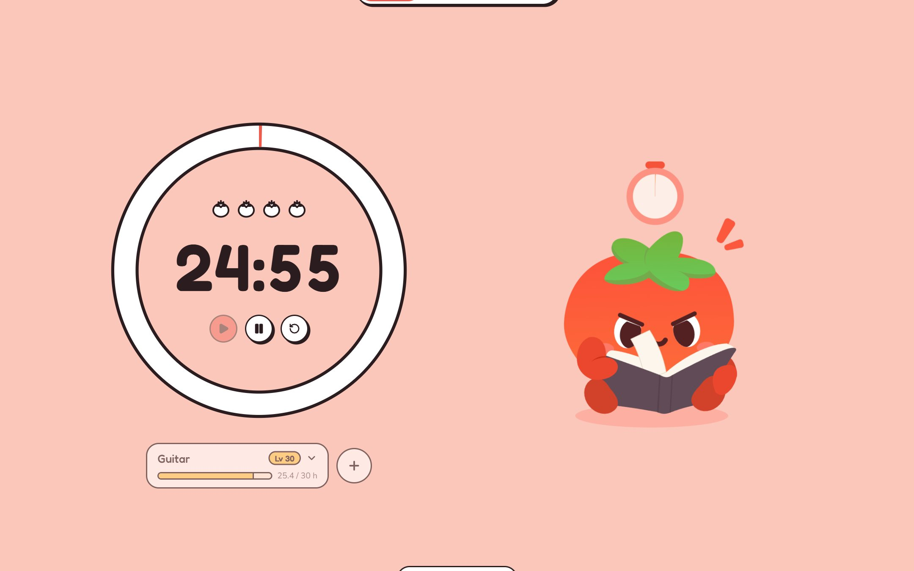
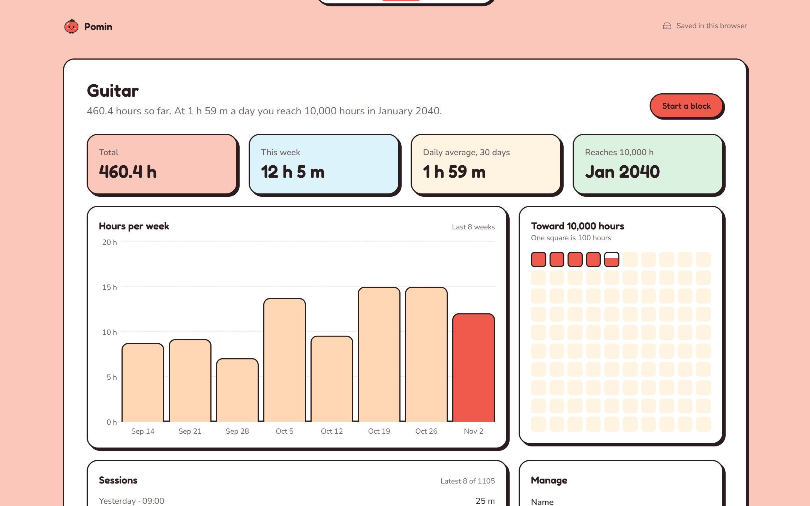
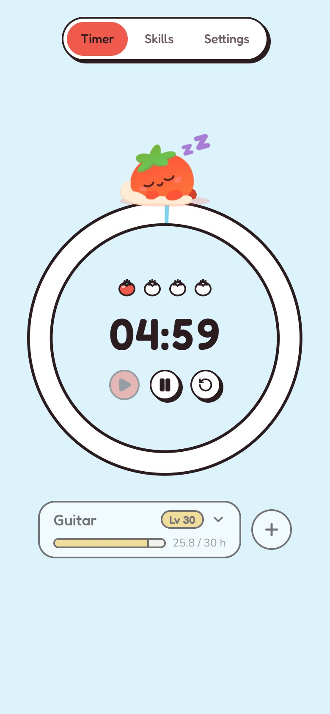

# Pomin

**A pomodoro timer that turns practice into progress.** Pomin records every focus block against a skill, so you can see how far you are on the road to 10,000 hours of deliberate practice in each one, and when you will get there at your current pace. Pomin, the tomato mascot, keeps you company: it reads beside you while you focus and sleeps through your breaks.

It works fully offline with no account. An optional account syncs your practice across devices.

**[Try it at pomin.vercel.app →](https://pomin.vercel.app)**



## Contents

- [Features](#features)
- [Screenshots](#screenshots)
- [Tech stack](#tech-stack)
- [How it works](#how-it-works)
- [Getting started](#getting-started)
- [Accounts and sync](#accounts-and-sync-optional)
- [Deploying](#deploying)
- [Scripts](#scripts)
- [Project structure](#project-structure)
- [Design](#design)
- [License](#license)

## Features

### The timer

- A focus, short break and long break cycle. Pick a preset (25/5/15, 30/10/30 or 50/10/30 minutes) or set each length yourself, from 1 to 180 minutes.
- Choose how many focus blocks make a round (1 to 12) before the long break. The round shows as a row of tomatoes that ripen as blocks are done.
- Breaks and focus blocks can start by themselves, so a whole session runs hands-free.
- Each phase has its own colour across the whole screen: tomato for focus, sky for a short break, leaf for a long one.
- Keyboard shortcuts on the timer page: <kbd>Space</kbd> starts or pauses, <kbd>S</kbd> skips, <kbd>R</kbd> resets. A hint lists them on hover.
- Skipping a focus block counts it in full, with its sound.
- The time also shows in the browser tab, so you can keep track from anywhere.

### Pomin, the mascot

Pomin is drawn in SVG and animated in CSS, and it acts out each phase of the timer:

- **Waiting:** it hops, waves, blinks and glances around.
- **Focusing:** it reads a book, with its eyes running along the lines and a page turning every few seconds. The stopwatch above its head fills clockwise as the block runs.
- **Resting:** it sleeps under a blanket, breathing slowly as the z's come and go.
- **Celebrating:** it cheers when a focus block ends, and cheers bigger when a round is complete.

On phones a smaller Pomin sits on top of the timer ring. Pomin is decorative: everything it shows is also stated in words, and it holds still for anyone who asks their system for reduced motion.

### Skills and progress

- Every focus block counts toward a skill. Every browser starts with a **Focus** skill, which also collects focus time that has no other skill.
- Under the ring, the skill shows as a quest card with a **level** and an XP bar. Levels follow a game curve: reaching level _L_ + 1 takes _L_ more hours, so early levels come fast and later ones take commitment.
- Each skill has its own page with:
  - total hours, hours this week, and the daily average over the last 30 days;
  - a **projection** of the month you reach the target at your current pace;
  - hours per week over the last 8 weeks;
  - a **mastery grid** of 100 squares toward 10,000 hours, one square per 100 hours;
  - the latest sessions.
- Skills can be renamed and archived. An archived skill keeps its hours but leaves the timer's list.

### Sound and alerts

- 8-bit sound effects made in the browser with the Web Audio API: a blip for each button, a chime when a focus block ends, and a fanfare when a round is done. No audio files are downloaded.
- Optional browser notifications when a phase ends while the tab is out of sight.

### Your data

- **Offline first.** Everything is kept in the browser's IndexedDB, so the app loads and works with no network at all.
- **Backups.** Save all skills, sessions and settings as a JSON file, and bring one back later. Restoring merges the file into what is already there and never deletes anything.
- **Accounts and sync (optional).** Sign in with an email link or GitHub to keep a copy in your account and use it on other devices.

## Screenshots

| A skill's progress                                                                                                                                                                                       | A break, on a phone                                                                                                        |
| -------------------------------------------------------------------------------------------------------------------------------------------------------------------------------------------------------- | -------------------------------------------------------------------------------------------------------------------------- |
|  |  |

## Tech stack

| Area              | Choice                                                                                      |
| ----------------- | ------------------------------------------------------------------------------------------- |
| Framework         | [Next.js 16](https://nextjs.org) (App Router, Turbopack, Cache Components) and React 19     |
| Language          | TypeScript, in strict mode                                                                  |
| Styling           | Tailwind CSS v4, with design tokens for every colour                                        |
| UI primitives     | [Radix UI](https://www.radix-ui.com) and [Lucide](https://lucide.dev) icons                 |
| Local data        | IndexedDB through [Dexie](https://dexie.org)                                                |
| Validation        | [Zod](https://zod.dev) schemas, which are also the source of the domain types               |
| Accounts and sync | [Supabase](https://supabase.com): Auth, Postgres with row-level security, and RPC functions |
| Sound             | Web Audio API, with every sound synthesised in code                                         |
| Tooling           | ESLint, Prettier and pnpm                                                                   |
| Hosting           | [Vercel](https://vercel.com)                                                                |

## How it works

**The timer runs on timestamps, not on intervals.** Its state is stored as the moment a phase started and how long it should last. The state is saved, and the remaining time is worked out from the clock on every tick, so the timer stays exact through a reload, a sleeping laptop or a tab running in the background.

**IndexedDB is the source the app reads.** Screens read from repositories on top of Dexie, and a change notifier refreshes them when data changes. The app is just as fast and offline-capable signed in as signed out.

**Sync is a background process.** When you are signed in, a sync engine:

- pushes records changed since its last push;
- pulls rows the server stamped since its last pull, through the `push_changes` and `pull_changes` Postgres functions.

Conflicts and deletions are handled like this:

- Each record keeps the version written last, by `updatedAt`.
- Deletions travel as tombstones.
- On a browser's first sync, its skills are merged into the account's skills of the same name.
- Signing out first makes sure your latest changes reached the account, then removes the account's data from that browser.

**Every boundary is validated.** Data read from storage, from an imported backup or from the network passes through Zod schemas before the app uses it.

## Getting started

### Requirements

- Node.js 26 or later (see `.nvmrc`)
- [pnpm](https://pnpm.io)

### Install and run

```bash
git clone https://github.com/jhotas/pomoapp.git
cd pomoapp
pnpm install
pnpm dev
```

Open http://localhost:3000. With no further setup the app runs entirely in the browser.

### Environment variables

All of them are optional. They are needed only for accounts and sync. Put them in `.env.local`:

| Variable                               | Description                                                          |
| -------------------------------------- | -------------------------------------------------------------------- |
| `NEXT_PUBLIC_SUPABASE_URL`             | The Supabase project URL, such as `https://your-project.supabase.co` |
| `NEXT_PUBLIC_SUPABASE_PUBLISHABLE_KEY` | The project's publishable key (`sb_publishable_...`)                 |
| `NEXT_PUBLIC_SUPABASE_GITHUB_ENABLED`  | `true` to offer GitHub sign-in, once it is enabled in Supabase       |

Without the first two, the account section explains that accounts are not set up and the rest of the app works as usual.

## Accounts and sync (optional)

1. Create a [Supabase](https://supabase.com) project. In **SQL Editor**, run [`supabase/migrations/20261029120000_accounts_and_sync.sql`](supabase/migrations/20261029120000_accounts_and_sync.sql). It creates the `skills` and `sessions` tables with row-level security, and the `push_changes` and `pull_changes` functions.
2. In **Authentication → URL Configuration**:
   - set the site URL to your deployed address;
   - add `http://localhost:3000/**` and your deployed URL to the redirect URLs.
3. Copy the project URL and the publishable key from **Project Settings → API Keys** into `.env.local`.
4. **Email.** Supabase's built-in email service sends only a few emails an hour, so sign-in links soon fail with _email rate limit exceeded_. Connect your own SMTP provider in **Authentication → Emails → SMTP Settings**, then raise the limit in **Authentication → Rate Limits**. With [Resend](https://resend.com), use host `smtp.resend.com`, port `465`, user `resend` and an API key as the password.
5. **GitHub sign-in (optional).**
   - Create a GitHub OAuth app with the callback `https://<your-project>.supabase.co/auth/v1/callback`.
   - Enable GitHub under **Authentication → Providers** with its client ID and secret.
   - Set `NEXT_PUBLIC_SUPABASE_GITHUB_ENABLED=true`.

## Deploying

The app deploys to [Vercel](https://vercel.com) with no extra configuration:

The live app is at [pomin.vercel.app](https://pomin.vercel.app).

1. Import the repository at [vercel.com/new](https://vercel.com/new). Vercel detects Next.js and pnpm by itself.
2. Add the environment variables above **before the first build**. Next.js writes `NEXT_PUBLIC_` values into the bundle at build time, so changing one later needs a redeploy.
3. Add the deployed URL to Supabase's site URL and redirect URLs.

Every push to `main` then deploys to production.

## Scripts

| Script              | What it does                                        |
| ------------------- | --------------------------------------------------- |
| `pnpm dev`          | Start the development server                        |
| `pnpm build`        | Build for production                                |
| `pnpm start`        | Serve the production build                          |
| `pnpm lint`         | Lint with ESLint                                    |
| `pnpm typecheck`    | Generate route types and type-check with TypeScript |
| `pnpm format`       | Format all files with Prettier                      |
| `pnpm format:check` | Check formatting without writing                    |

## Project structure

```text
src/
├── app/                  Routes: the timer (/), skills, a skill's page, settings
│   └── globals.css       Design tokens, utilities and Pomin's animations
├── data/                 Schemas, Dexie database, repositories, backups, settings
├── features/
│   ├── account/          Supabase client, sign-in and the sync engine
│   ├── backup/           Saving and restoring a JSON copy
│   ├── progress/         Totals, weekly chart, mastery grid, projection, levels
│   ├── sessions/         Today's sessions
│   ├── skills/           Skill list, skill page, adding a skill
│   ├── sound/            Chiptune sound effects with Web Audio
│   └── timer/            Timer core, store, shortcuts, alerts and the timer screen
├── lib/                  Small shared hooks and time formatting
└── ui/                   Shared components: shell, navigation, buttons, Pomin
supabase/migrations/      The database schema for accounts and sync
```

The source art for Pomin's scenes is in `idle.svg`, `working.svg` and `resting.svg` at the repository root. Each one is split into animated layers in `src/features/timer/components/pomo-*.tsx`.

## Design

The product and technical design is in [`docs/superpowers/specs/2026-10-29-pomoapp-design.md`](docs/superpowers/specs/2026-10-29-pomoapp-design.md), and the implementation plan for each part is in [`docs/superpowers/plans/`](docs/superpowers/plans/). Pomin was called pomoapp when they were written.

## How this was built

This project is developed with [Claude Code](https://claude.com/claude-code) as an AI pair programmer. Commits it wrote carry a `Co-Authored-By` trailer.

## License

Pomin is released under the [MIT License](LICENSE).
